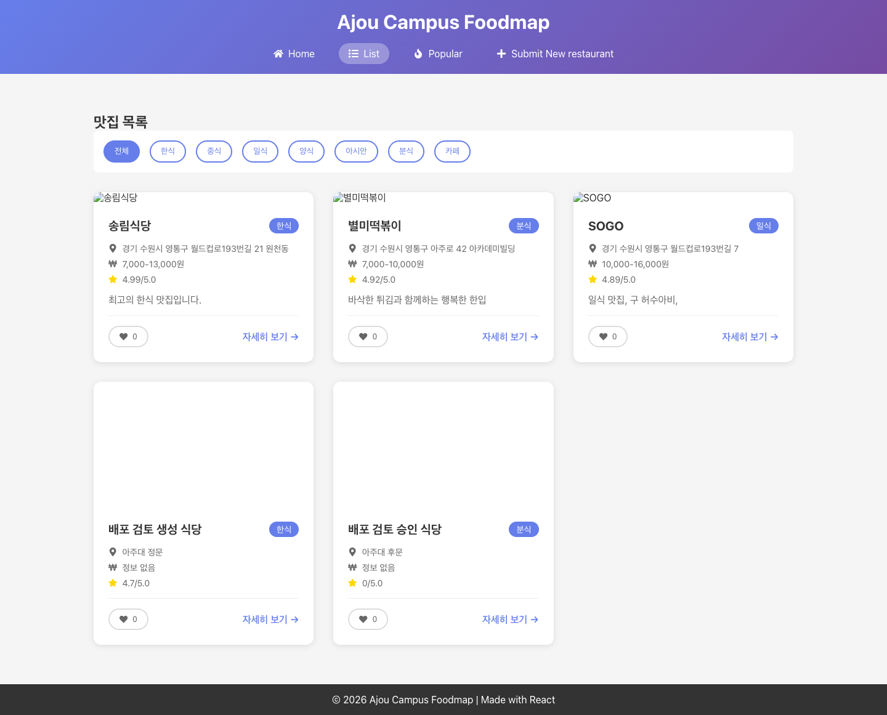
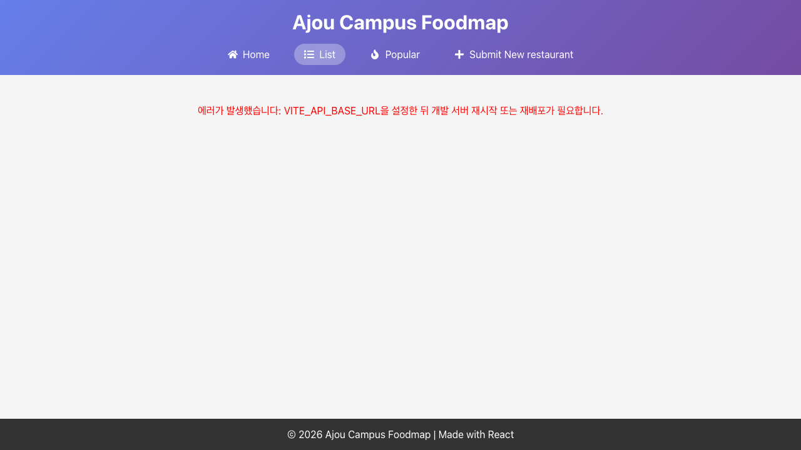

# README 배포·클라이언트 연동 실습 검토

실행 검증일: 2026년 10월 15일 · 검토 기준 정리: 2026년 10월 16일

## 실습 성공 기준과 판정

이번 검토는 다음 세 가지로 판정한다.

1. Render에 백엔드가 배포되고 상태 확인·맛집 조회·등록 API가 정상 응답한다.
2. Vercel에 React 클라이언트가 배포되고 목록·상세·인기 화면에 백엔드 데이터가 표시된다.
3. 클라이언트의 맛집 등록과 제보 승인에서 백엔드 API를 호출하고, 결과가 목록에 반영된다.

**배포 설정과 클라이언트의 API 사용을 재현한 로컬 시뮬레이션은 통과했다.** 현재 잠금 파일로 백엔드와 클라이언트의 설치·빌드가 성공했고, 빌드 결과를 실행해 조회·등록·제보 승인 연동을 확인했다. README의 배포·연동 예제를 따라 실습을 진행할 수 있다.

실제 계정에서 Render/Vercel 리소스를 생성하거나 공개 HTTPS 주소로 배포하지는 않았다. 실제 배포 완료 여부는 Render의 Live, Vercel의 Ready와 두 서비스 사이의 Network 요청·화면 반영으로 확인한다. 아래 결과는 기존 실행 기록을 이 실습 기준에 맞춰 정리한 것으로, 새로운 배포를 수행했다는 의미는 아니다.

## 검증 방법

- Node **24.21.0**, npm **11.20.0**, macOS ARM64, Playwright **1.64.1**, Chrome headless를 사용했다.
- 현재 백엔드 소스와 기존 잠금 파일의 복사본에서 `npm ci --include=dev`로 설치했다.
- README의 설정·소스·시드 JSON·테스트 코드 블록만 빈 폴더에 추출하고 `npm install --include=dev`로 설치하는 경로도 검증했다.
- 실제 `pwd-week5`의 임시 복사본에 README Step 11의 API 모듈 교체와 관리자 버튼 비활성화를 적용했다.
- Render 실행은 `dist/`와 package 파일만 있는 별도 폴더에서 프로덕션 의존성을 설치하고 `NODE_ENV=production`, `PORT=10000`, `npm start`로 재현했다.
- Vercel 실행은 클라이언트의 `dist/`를 백엔드와 다른 origin에서 정적으로 제공해 재현했다. 브라우저는 개발 프록시 없이 API에 직접 요청했다.
- 배포 화면의 이동 경로와 설정값은 2026년 10월 15일 확인한 공식 공개 문서·게시 화면을 기준으로 대조했다.

## 실행 결과

| 실습 단계 | 결과 |
| --- | --- |
| 현재 소스·기존 잠금 파일로 백엔드 신규 설치 | 통과 |
| README 코드 블록만으로 백엔드 재구성·설치 | 통과 |
| 두 백엔드의 타입 검사·테스트·빌드 | 각각 통과, 동일 Jest 테스트 **22개** |
| 빌드 결과에 서버 JavaScript와 시드 JSON 포함 | 통과 |
| 빌드 결과와 실행 의존성만으로 서버 시작 | 통과 |
| 상태·목록·상세·인기·동기 비교 API | 통과 |
| 등록 201·메뉴 정규화·데모 초기화 | 통과 |
| 다른 origin의 클라이언트 요청과 CORS 사전 요청 | 통과 |
| README 연동 예제를 적용한 클라이언트 타입 검사·lint·빌드 | 통과 |
| 브라우저 연동 | **9개 시나리오 통과**, 처리되지 않은 JavaScript 오류 0개 |

브라우저에서 다음을 확인했다.

1. 목록이 실제 백엔드 API를 호출해 표시된다.
2. 상세 주소 직접 진입과 새로고침이 동작한다.
3. 인기 화면이 백엔드의 인기 조회 API를 사용한다.
4. 이번 서버에 없는 수정·삭제 API의 버튼이 비활성화되어 있다.
5. 관리자 화면에서 등록하면 POST 201을 받고 목록에 반영된다.
6. 로컬 제보를 승인하면 백엔드 등록 API가 호출된다.
7. 없는 ID에 대해 오류 화면이 표시된다.
8. API 연결 실패가 화면에 표시된다.
9. 관리자 등록과 제보 승인 후 목록이 시드 3개에서 5개로 늘어난다.

[백엔드 설치·검증 기록](deployment-review-2026-10-15/repository-checks.json), [README 재구성 기록](deployment-review-2026-10-15/readme-checks.json), [클라이언트 빌드 기록](deployment-review-2026-10-15/client-checks.json), [브라우저 결과와 Network 기록](deployment-review-2026-10-15/browser-results.json)

## 배포·연동 안내의 보완 사항

- **실제 클라이언트에 API 모듈 적용:** README Step 11의 교체 코드는 임시 복사본에서 검증했다. 실제 `pwd-week5`에도 적용하고 커밋·푸시해야 Vercel 배포에 반영된다.
- **Vercel 환경변수:** `VITE_API_BASE_URL`이 없어도 Vite 빌드는 성공했다. 따라서 Ready 상태를 확인한 뒤, 실제 Render 주소로 요청하는지 Network와 화면에서 확인해야 한다. 환경변수 누락 시 클라이언트에 설정 오류가 표시되는 것을 확인했다.
- **Node 버전과 설정 화면:** Render의 검증 버전과 Vercel의 Node 24.x 설정·package 우선순위를 명시했다. Vercel 생성 폼에 버전 항목이 없다면 생성 후 Settings에서 확인하도록 안내했다.
- **Vercel 변수 유형:** 공개 API 주소는 현재 화면의 Config 유형으로 등록하도록 명시했다.

환경변수 변경은 새 배포에 반영하므로, 변경 후 재배포하고 API 요청 주소를 다시 확인한다. [Vercel 환경변수 관리](https://vercel.com/docs/environment-variables/managing-environment-variables)

## Render 최신 절차 시뮬레이션

| 단계 | README에서 사용할 설정·이동 경로 | 확인 결과 |
| --- | --- | --- |
| 계정 연결 | Account Settings → Account Security → Git Deployment Credentials → Add credential | 공식 시작 가이드와 일치 |
| 생성 | + New → Web Service → Git Provider → 저장소 Connect | 공식 시작 가이드와 일치 |
| 저장소·루트 | `pwd-week6`, 실제 배포 브랜치, Root Directory 비움 | 루트에 package 파일·서버·스크립트가 있음 |
| 런타임 | Language `Node`, `NODE_VERSION=24.21.0`, `NODE_ENV=production` | 동일 Node·환경에서 설치·빌드·실행 통과 |
| 빌드 | `npm ci --include=dev && npm run build` | 기존 잠금 파일로 성공; 시드 JSON 포함 |
| 시작 | `npm start`; 플랫폼 PORT 사용 | PORT 10000에서 수신, 프로덕션 의존성만으로 실행 성공 |
| 플랜 | Compute 또는 Instance Type에서 `Free` | 공식 문서의 두 표기를 README가 설명함 |
| 상태 검사 | Settings → Health Checks → Edit → `/health` | `200`, `{"status":"ok"}`; 루트 `/`는 예상대로 404 |
| 생성 버튼 | 최신 시작 가이드는 `Deploy`; Web Services 문서는 `Create Web Service` | 문서별 표기 차이를 README가 안내함 |
| 자동 배포 | Settings → Auto-Deploy → `On Commit` | CI가 없는 이 저장소에 적합 |
| 환경변수 변경 | Environment에서 저장·재실행·재빌드 옵션 선택 | 세 옵션의 설명과 일치 |

서비스 생성·상태 화면의 최종 `Live`는 실제 계정에서 확인해야 한다. 문서에 안내된 포트·빌드 요구사항을 로컬에서 통과한 결과이지 실제 Render 배포 성공 기록은 아니다. Node `>=22` 범위는 버전을 고정하지 않으므로 명시적인 `NODE_VERSION`을 유지한다. [Render 시작 가이드](https://render.com/docs/your-first-deploy), [Node 버전 선택](https://render.com/docs/node-version)

`After CI Checks Pass`는 검사 결과가 하나도 없으면 자동 배포하지 않는다. 현재 CI가 없으므로 `On Commit`을 유지한다. 환경변수의 `Save only` 역시 실행 중 서비스에 즉시 반영되지 않는다. [자동 배포 조건](https://render.com/docs/deploys#configuring-auto-deploys), [환경변수 저장 동작](https://render.com/docs/configure-environment-variables#in-the-render-dashboard)

Free 서비스가 대기 상태라면 먼저 `/health` 응답을 기다린 뒤 클라이언트 연동을 확인한다. 등록한 맛집은 서버를 재시작하지 않은 상태에서 목록 반영을 확인한다. 실제 Free 서비스의 기동 시간은 이번 시뮬레이션에 포함하지 않았다. [Free 서비스의 기동 동작](https://render.com/docs/free)

## Vercel 최신 절차 시뮬레이션

| 단계 | README에서 사용할 설정·이동 경로 | 확인 결과 |
| --- | --- | --- |
| 저장소 가져오기 | Add New… → Project, React `pwd-week5` 저장소 Import | Express 저장소와 구분해야 함 |
| 프레임워크 | Framework Preset `Vite` | 실제 클라이언트와 일치 |
| 빌드 | Build `npm run build`, Output `dist`, 클라이언트 루트 | 신규 설치·타입 검사·lint·빌드 통과 |
| Node | package의 `engines.node: "24.x"`; Settings → Build and Deployment → Node.js Version | package 설정이 우선; 생성 폼에 필드가 없어도 확인 가능하도록 보완 |
| API 주소 | `VITE_API_BASE_URL=https://실제서비스.onrender.com`, Production·Preview | 빌드 시 반영됨; 누락 시 빌드 성공 후 화면 오류 재현 |
| 변수 유형 | `Config` | 2026-08-24 변경 공지에 맞게 명시 |
| 배포 확인 | Deploy → Deployments → Ready → 실제 Production URL의 Network | 정적 빌드와 다른 origin의 API 연동 통과; 실제 Ready 상태는 미검증 |
| 브랜치 | Settings → Environments → Production → Branch Tracking | 현재 공식 Git 문서와 일치 |
| 재배포 | Deployments → … → Redeploy | 설정 변경 후 새 빌드가 필요함 |
| 새로고침 | 실제 HashRouter 주소 `/#/restaurant/1` | 정적 서버의 직접 진입·새로고침 통과; 현재 구성은 SPA rewrite 불필요 |

Vercel은 현재 24.x와 22.x를 지원하며 메이저 버전만 선택한다. 생성 폼과 생성 후 Settings 화면을 혼동하지 않도록 Node 설명을 다듬었다. [빌드 설정 화면](https://vercel.com/docs/builds/configure-a-build), [지원 Node 버전과 우선순위](https://vercel.com/docs/functions/runtimes/node-js/node-js-versions)

환경변수의 기존 Sensitive 토글은 Config·Secret 선택으로 변경되었다. 공개 API 주소는 Config를 사용한다. Production 브랜치와 Redeploy 이동 경로는 현재 공식 문서와 일치한다. [변수 유형 변경 공지](https://vercel.com/changelog/environment-variables-now-use-config-and-secret-types), [Production 브랜치 설정](https://vercel.com/docs/git#customizing-the-production-branch), [Redeploy 메뉴](https://vercel.com/docs/deployments/managing-deployments#redeploy-a-project)

## 실제 배포에서 확인할 순서

1. 검증한 백엔드 소스·설정·잠금 파일을 Render 연결 브랜치에 커밋·푸시한다.
2. 실제 `pwd-week5`에 README Step 11을 적용하고 타입 검사·lint·빌드를 확인한 뒤 푸시한다.
3. Render에서 해당 커밋이 Live인지 확인하고 `/health`, 맛집 조회·등록 API를 호출한다.
4. Vercel에 실제 Render 주소를 환경변수로 등록하고, 해당 배포가 Ready인지 확인한다.
5. Vercel 클라이언트에서 목록·상세·인기 조회와 등록·제보 승인을 실행하고, Network의 Render 요청 및 목록 반영을 확인한다.

## 검증 자료

- [실행 환경·소스 지문·실습 판정 요약](deployment-review-2026-10-15/summary.json)
- [브라우저 검증 결과와 Network 기록](deployment-review-2026-10-15/browser-results.json)

