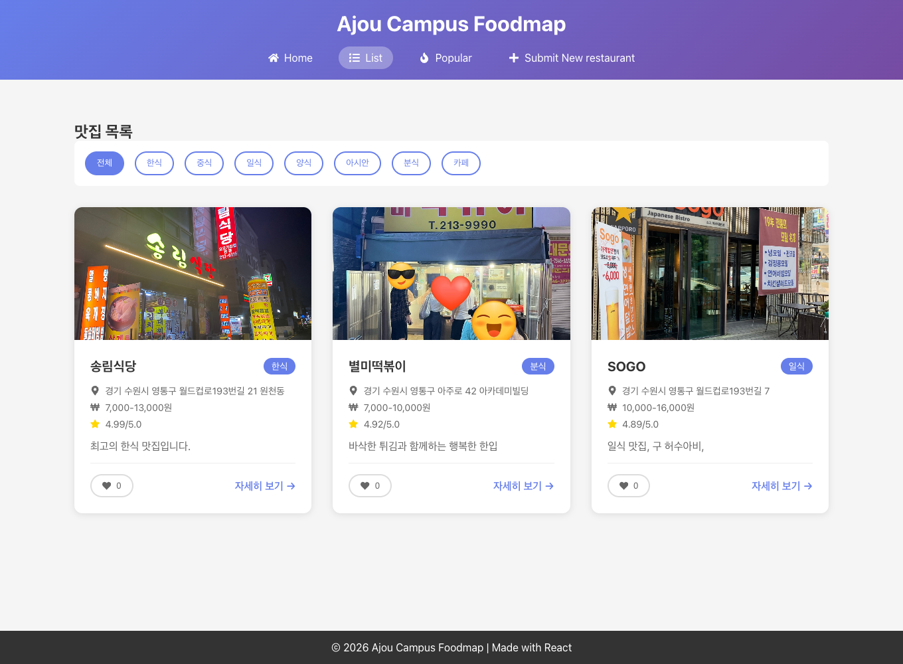
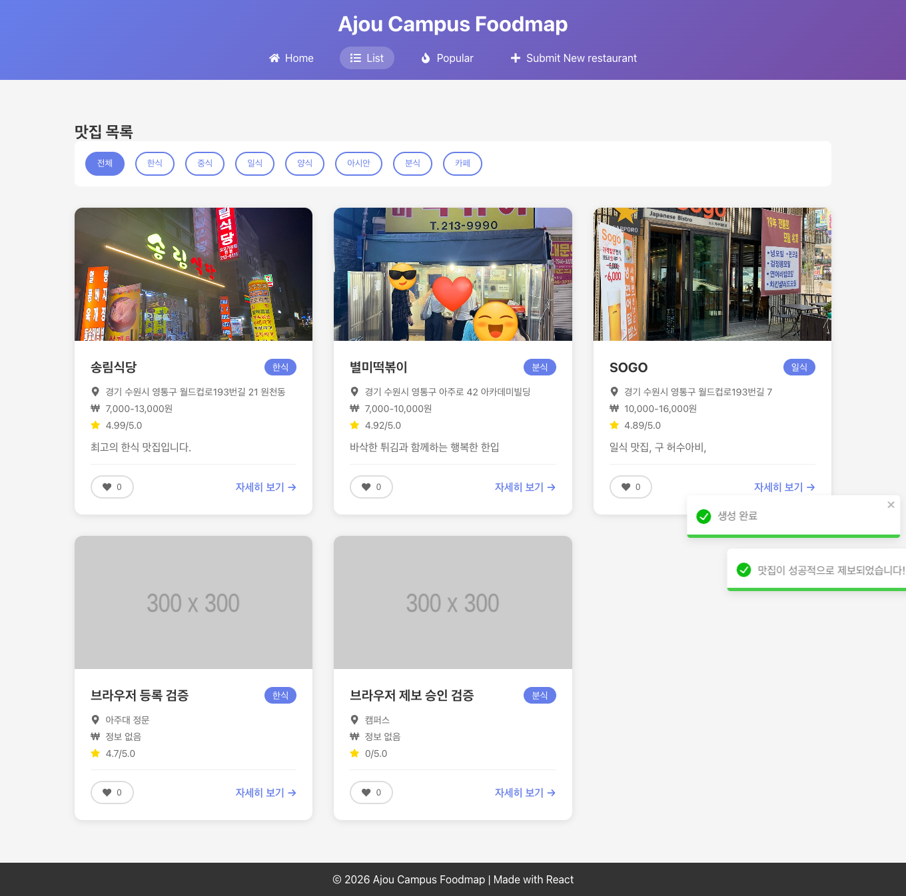

# README 배포 실습 시뮬레이션 검증

검증일: 2026년 10월 15일

수정 전 README에서는 실행 순서와 클라이언트 API 교체 때문에 실습이 중단됐습니다. 해당 안내를 고친 뒤, 백엔드 설치부터 실제 React 클라이언트의 빌드·브라우저 연동까지 로컬 시뮬레이션이 모두 통과했습니다.

## 검증 환경과 대상

- macOS ARM64, Node.js **24.21.0**, Chrome headless, Playwright **1.64.1**을 사용했습니다.
- 백엔드는 README의 설정·TypeScript·시드 JSON 블록을 빈 임시 폴더에 추출해 재구성했습니다. 별도로 현재 작업 파일과 기존 `package-lock.json`을 복사한 설치 경로도 검증했습니다.
- 클라이언트는 실제 `pwd-week5` 저장소의 임시 복사본에 수정된 README Step 11을 적용했습니다.
- Render는 `NODE_ENV=production`, `PORT=10000`으로 실행했습니다. Vercel은 클라이언트 프로덕션 빌드 결과를 백엔드와 다른 origin에서 정적으로 제공하는 방식으로 재현했습니다.
- 로그인, 서비스 생성, Git commit·push, 공개 도메인 배포는 수행하지 않았습니다. Linux 컨테이너와 Windows PowerShell 실행도 검증 범위에 포함하지 않았습니다.

## 발견한 문제와 README 수정

| 문제 | 재현한 결과 | 반영한 수정 |
| --- | --- | --- |
| 빈 프로젝트에서 Step 3 실행이 Step 5 코드 작성보다 빠름 | `server.ts`를 찾지 못해 `ERR_MODULE_NOT_FOUND` 발생 | 빈 폴더에서는 설정·설치 후 Step 4~5 파일을 먼저 만들도록 실행 순서 명시 |
| 초기 Git 등록 전 `.gitignore` 작성 절차 누락 | 새 프로젝트에서 의존성·빌드 파일 제외 설정이 준비되지 않음 | Git 등록 전에 `.gitignore` 작성 블록 추가, 실제 `git check-ignore` 검증 |
| 클라이언트를 `pwd-week3`로 안내 | 실제 `pwd-week3`는 계산기이며 React 맛집 앱은 `pwd-week5` | 주차·저장소·제출 주소를 현재 프로젝트에 맞게 수정 |
| API 파일을 조회 함수 세 개로 전부 교체 | `submissionAPI`, `createRestaurant`, `updateRestaurant`, `deleteRestaurant` 누락으로 TypeScript 빌드 실패 | 원래 모듈을 `api.local.ts`로 보관하고 기존 타입·제보 API를 유지하는 연동 코드로 교체 |
| 서버에 없는 맛집 수정·삭제 기능 노출 | 클라이언트에는 버튼이 있지만 서버 라우트가 없음 | 두 버튼을 비활성화하는 코드와 이번 주 지원 기능 표 추가 |
| 요청 실패 시 대체 데이터로 성공처럼 보임 | 기존 예제는 실패를 로컬 목록으로 대체 | API 실패와 환경변수 누락을 화면 오류로 전달하는 방식으로 수정 |
| 실제 클라이언트의 Node 버전과 라우터 안내 부족 | 클라이언트는 `engines.node: "24.x"`, `HashRouter` 사용 | Node 24.x와 `/#/list`, `/#/restaurant/1` 경로 명시 |

수정 전 컴파일 오류는 [실패 로그](readme-simulation-2026-10-15/logs/client-readme-before-build.txt), 소스 작성 전 실행 오류는 [실행 로그](readme-simulation-2026-10-15/logs/backend-step3-before-source.txt)에 보관했습니다.

## 실행 검증 결과

| 검증 | 결과 |
| --- | --- |
| README만으로 재구성한 백엔드 의존성 설치·타입 검사·빌드 | 통과 |
| 재구성한 백엔드 Jest 테스트 | **22개 통과** |
| 현재 저장소의 잠금 파일로 새로 설치·타입 검사·테스트·빌드 | 통과, 동일 테스트 **22개 통과** |
| 개발 서버 실행·소스 저장 후 자동 재시작 | 통과 |
| `NODE_ENV=production`에서 개발 의존성 포함 설치·빌드 | 통과 |
| `dist/`, package 파일, 프로덕션 의존성만으로 실행 | 통과, 원본 `src/`·TypeScript·tsx 없이 실행 |
| `PORT=10000`, `/health`, 목록·상세·인기·동기 조회 | 통과 |
| 없는 ID·루트 경로의 404, 필수 값 누락의 400 | 통과 |
| 프로덕션 오류 응답에서 stack 제외 | 통과 |
| CORS와 JSON POST 사전 요청(OPTIONS) | 통과 |
| 등록 201, 메뉴 정규화, 초기화 200 | 통과 |
| 서버 재시작 후 시드 3개로 복원 | 통과 |
| `node --env-file=.env dist/server.js` | 통과 |
| 수정된 클라이언트 타입 검사·lint·빌드 | 통과 |
| 환경변수가 실제 배포 번들에 반영되는지 확인 | 통과 |

백엔드 테스트 22개를 두 가지 설치 경로에서 반복 검증한 결과이며, 서로 다른 44개 테스트라는 의미는 아닙니다.

## 실제 브라우저 검증 10개

1. Vite 개발 서버가 환경변수를 읽어 실제 API 목록을 표시했습니다.
2. 프로덕션 정적 빌드가 다른 origin의 API를 호출하고 목록을 표시했습니다.
3. 상세 화면과 HashRouter 주소 새로고침이 정상 동작했습니다.
4. 인기 목록이 서버의 인기 조회 API를 사용했습니다.
5. 서버가 지원하지 않는 맛집 수정·삭제 버튼이 비활성화됐습니다.
6. 관리자 생성 버튼으로 POST 201을 받고 목록에 신규 맛집이 표시됐습니다.
7. 제보가 LocalStorage에 기록되고, 같은 브라우저에서 승인하면 서버에 맛집이 등록됐습니다.
8. 존재하지 않는 ID는 404와 오류 화면으로 처리됐습니다.
9. `VITE_API_BASE_URL` 누락 시 설정 오류를 표시하고 대체 목록을 보여주지 않았습니다.
10. 처리되지 않은 브라우저 JavaScript 오류가 없었습니다.

실제 API 목록은 시드 3개에서 관리자 등록·제보 승인 후 **5개**가 됐고, 서버 재시작 뒤에는 다시 **3개**가 됐습니다. 404 오류 처리 검증 중 발생한 브라우저의 HTTP 404 콘솔 기록은 예상 결과이며, 처리되지 않은 JavaScript 오류와 구분했습니다.

[브라우저 결과와 Network 기록](readme-simulation-2026-10-15/browser-results.json) · [전체 요약 JSON](readme-simulation-2026-10-15/summary.json)

## 화면 증거

## 실제 배포에 적용할 조건

검증한 대상은 수정된 README 절차를 적용한 임시 프로젝트입니다. 실제 배포를 진행할 때는 다음 내용을 반영해야 합니다.

- `pwd-week6`의 TypeScript 전환 파일·설정·README를 배포 브랜치에 커밋·푸시합니다. 현재 작업 폴더의 미커밋 파일은 Render가 가져갈 수 없습니다.
- 실제 `pwd-week5` 클라이언트에도 README Step 11의 `api.local.ts` 보관, 새 `api.ts`, 관리자 버튼 비활성화를 적용한 뒤 커밋·푸시합니다.
- Render는 문서의 빌드·시작 명령, Node 버전, `/health`를 설정합니다.
- Vercel은 실제 클라이언트 저장소, Node 24.x, Vite, `dist`를 선택합니다. `VITE_API_BASE_URL`에는 실제 Render HTTPS 주소를 등록하고 새로 배포합니다.
- 공개 배포에서는 Render `Live`, Vercel `Ready`, 실제 HTTPS 도메인의 Network 요청을 최종 확인합니다. 이 계정·플랫폼 단계의 성공은 로컬 시뮬레이션 결과와 별도로 확인해야 합니다.
